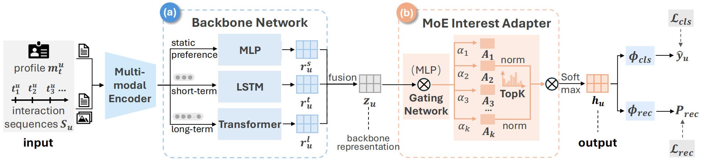
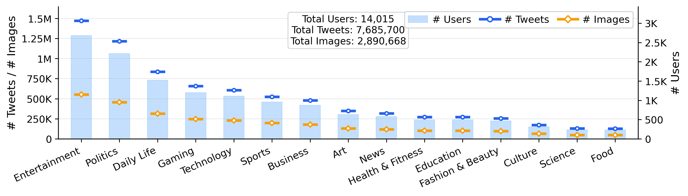

# DUMoE

**Official PyTorch implementation** for

> **Drift-Aware Multimodal User Representation Learning via Multi-Scale Temporal Modeling and Sparse Mixture-of-Experts**  
> [[arXiv]](https://arxiv.org/abs/2608.25773)

<p align="center">
  <a href="https://arxiv.org/abs/2608.25773"></a>
  <a href="LICENSE"></a>
  
  
</p>

---

## 🔥 Overview

Understanding user preferences from noisy, temporally evolving social media behavior is challenging because of **interest drift**: preferences shift over time, exhibit both short- and long-term patterns, and span multiple co-existing interests.

**DUMoE** (*Drift-aware User Modeling with Mixture-Of-Experts*) is a unified framework for drift-aware multimodal user representation learning. It jointly models multimodal signals, multi-scale temporal dynamics, and multi-interest structure:

- ⏱️ **Temporal dynamics-aware backbone** — fuses static profile signals (MLP), short-term behavior (LSTM), and long-term dependencies (Transformer) into a coherent user vector \(\mathbf{z}_u\).
- 🧩 **Sparse MoE interest adapter** — specialized experts model distinct interest subspaces; a gating network selects and aggregates a sparse Top-\(K\) subset of experts to produce \(\mathbf{h}_u\).
- 🎯 **Three-stage training** — Stage 1 backbone → Stage 2 expert specialization → Stage 3 gating, with multitask loss \(L = L_{\mathrm{cls}} + 1.5\, L_{\mathrm{rec}}\).

<p align="center">
  
</p>
<p align="center"><em>Figure 1. DUMoE overview: (a) temporal dynamics-aware backbone and (b) sparse MoE interest adapter, with dual heads for interest classification and interaction prediction.</em></p>

---

## 🧠 Framework

| Module | What it does |
| --- | --- |
| **Input** | User profile \(m_t^u\) + multimodal interaction sequence \(S_u\) (text & images), encoded by a multimodal encoder (UNITE) |
| **(a) Backbone** | Static / short-term / long-term branches → fusion → \(\mathbf{z}_u\) |
| **(b) MoE adapter** | Gating + Top-\(K\) experts → \(\mathbf{h}_u\) |
| **Output** | Classification head \(\phi_{\mathrm{cls}}\) (\(L_{\mathrm{cls}}\)) and recommendation head \(\phi_{\mathrm{rec}}\) (\(L_{\mathrm{rec}}\)) |

**Paper main result = staged training** (`scripts/run_dumoe_staged.sh`). Joint end-to-end training is provided as an ablation (`scripts/run_dumoe_joint.sh`).

Downstream evaluation freezes the encoder and probes:

| | **Task A** — Interest classification | **Task B** — Interaction prediction |
| --- | --- | --- |
| Goal | Predict the 15-way interest of window \(t\) | Predict whether a candidate post is interacted in window \(t\) |
| Input | \(\mathbf{z}_t\) | \(\mathbf{z}_{t-1}\) + tweet embedding |
| Metrics | Hit@1, NDCG@3, Recall, KL | Acc, Recall, F1, BCE |

---

## 📦 Dataset

We release a large multimodal user dataset collected from **X** (formerly Twitter) via the official API (Nov 2025 – Mar 2026).

| | Count |
| --- | ---: |
| Users | **14,015** |
| Posts | **7,685,700** |
| Posts with images | **2,890,668** |
| Interest domains | **15** |

<p align="center">
  
</p>
<p align="center"><em>Per-domain distribution of users, tweets, and images.</em></p>

**Public release = ids only** (no post text, images, or usernames), following X redistribution rules. Unpack:

```bash
unzip dataset/ids/dumoe_ids.zip -d dataset/ids
```

| File | Rows | Contents |
| --- | ---: | --- |
| `users.csv` | 14,015 | numeric `user_id` |
| `posts.csv` | 7,685,700 | `user_id,post_id` (newest → oldest) |
| `windows.csv` | 156,757 | `user_id,window_idx,label_id,split_tag` |

Windows are **30** posts each (newest-first); split by index **0–7** train / **8–9** val / **10–11** test. Full docs, 15 labels, and preprocessing notes: [`dataset/README.md`](dataset/README.md).

> Questions about the dataset? Contact us (see below).

---

## ⚙️ Requirements

```text
Python >= 3.9
PyTorch >= 2.0
```

```bash
pip install -r requirements.txt
```

---

## 🚀 Quick Start

### 1️⃣ Clone & install

```bash
git clone https://github.com/idvxlab/DUMoE.git
cd DUMoE
python -m venv .venv && source .venv/bin/activate
pip install -r requirements.txt
```

### 2️⃣ Unpack id tables

```bash
unzip dataset/ids/dumoe_ids.zip -d dataset/ids
```

### 3️⃣ Prepare local artifacts

Hydrate posts with the [official X API](https://developer.x.com/) if you need text/images, then build UNITE embeddings locally. Configure paths:

```bash
cp configs/paths.example.env configs/paths.env
# edit configs/paths.env → profile .pt, tweet emb shards, samples, labels cache
source configs/paths.env
```

Place large local files under `dataset/local/` (gitignored).

### 4️⃣ Train DUMoE (paper main = staged)

```bash
bash scripts/run_dumoe_staged.sh
```

Runs Stage 1 → 2 → 3 with both heads (`cls_weight=1.0`, `rec_weight=1.5`). Hyperparameters: [`configs/paper_hparams.yaml`](configs/paper_hparams.yaml).

Joint ablation (optional):

```bash
bash scripts/run_dumoe_joint.sh
```

### 5️⃣ Train baselines

```bash
bash scripts/run_baselines.sh
```

Models: SASRec, BERT4Rec, MIND, PeterRec, PTUM, UniSRec, HORAE, DisMIR, HM4SR.

### 6️⃣ Downstream evaluation (frozen encoder)

```bash
bash scripts/run_downstream.sh   # Task A then Task B
bash scripts/run_taskA.sh        # 15-way window classification
bash scripts/run_taskB.sh        # next-window interaction
```

Protocol details: [`docs/downstream_protocol.md`](docs/downstream_protocol.md), [`downstream/README.md`](downstream/README.md).

### 7️⃣ Ablations

See [`dumoe/ablation/README.md`](dumoe/ablation/README.md).

---

## 📁 Repository Structure

```text
DUMoE/
├── assets/                 # figures (pipeline)
├── dumoe/                  # model + staged / joint training + ablations
├── downstream/             # Task A (classify) / Task B (interaction)
├── baselines/project/      # baseline pretraining + Exp1–3
├── dataset/                # stats, labels, preprocessing, id zip
├── scripts/                # one-command launchers
├── configs/                # paper hparams + path template
└── docs/                   # Task A / Task B protocol
```

**Not shipped:** post text, images, usernames, UNITE embeddings, checkpoints, cookies, or API keys.

---

## 📎 Citation

If you use this code or dataset, please cite:

```bibtex
@article{qian2026dumoe,
  title={Drift-Aware Multimodal User Representation Learning via Multi-Scale Temporal Modeling and Sparse Mixture-of-Experts},
  author={Qian, Ziqing and Chen, Haohang and Dang, Shengqi and Xiong, Yuhan and Shen, Canyu and Lei, Jiaying and Cao, Nan},
  journal={arXiv preprint arXiv:2608.25773},
  year={2026}
}
```

---

## ✉️ Contact

- Ziqing Qian — qianziqing0719@gmail.com  
- Corresponding author: Nan Cao  

Intelligent Design & InnoVation Lab ([idvxlab](https://github.com/idvxlab)), Tongji University

## 📄 License

Code is released under the [MIT License](LICENSE).  
Dataset ids are for research use; any hydrated X content remains under **X’s terms**.
