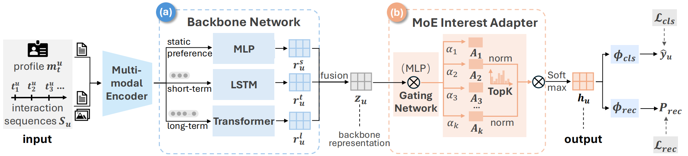

# DUMoE

This repository contains the official implementation of **DUMoE**, proposed in the paper:

**Drift-Aware Multimodal User Representation Learning via Multi-Scale Temporal Modeling and Sparse Mixture-of-Experts**

*NeurIPS 2026*

## Overview

DUMoE is a drift-aware multimodal user representation learning framework designed to capture evolving user interests from social media behaviors.

The framework consists of two main components:

- **Temporal Dynamics-Aware Backbone Network:** Integrates static user profiles, short-term behavioral patterns, and long-term temporal dependencies to learn comprehensive user representations.
- **Sparse Mixture-of-Experts (MoE) Interest Adapter:** Employs expert specialization and adaptive sparse routing to capture diverse user interests and model temporal interest drift.

DUMoE is evaluated on two downstream tasks:

1. **User Interest Classification**
2. **User Interaction Prediction**

## Framework

<p align="center">
  
</p>

## Dataset

We construct a large-scale multimodal social media dataset from X (formerly Twitter), covering 15 interest domains.

- **14,015** users
- **7,685,700** posts
- **2,890,668** images
- **15** interest categories

The released dataset contains anonymized user IDs and tweet IDs, with content filtering applied prior to distribution.

<!-- TODO: Add dataset download link and access instructions -->

## Requirements

The implementation is developed with Python and PyTorch.

<!-- TODO: Add the tested Python/PyTorch/CUDA versions and dependencies -->

## Installation

```bash
git clone <REPOSITORY_URL>
cd DUMoE

conda create -n dumoe python=3.11
conda activate dumoe

pip install -r requirements.txt
